# Design references: captured sites
Up: [[UI-Design-Ruleset]] · Related: [[WebUI Preferred Style Guide - Dataiku Dobre Ponder]] · [[ui-slop-patterns]] · [[qloop-ui-protocol]]

Captured 2026-11-19 at 1920×1080 with `ref-capture` (`AI-Agents/skills/ui-ux-qloop/scripts/ref-capture/`). Tokens are read from computed styles; library names are signatures found in scripts, evidence not proof. Cross-origin CSS cannot be read (count shown).

| Tier | Meaning | Skills in the stack |
|---|---|---|
| css | CSS transitions and keyframes only | transitions-dev |
| scripted | GSAP, Lenis, rAF loops or WAAPI drive the motion | gsap-animation, transitions-dev, react-bits |
| webgl | a real WebGL canvas or shaders | gsap-animation for the DOM layer; **no skill for WebGL / Three.js / shaders (gap)** |

| Site | Tier | Page transitions | Idle motion | Libraries |
|---|---|---|---|---|
| [svgator-com](#svgator-com) | css | - | yes | - |
| [svgator-com-blog-website-animation-examples-and-effects](#svgator-com-blog-website-animation-examples-and-effects) | css | - | no | three |

## svgator-com
<https://www.svgator.com/>

**What I like:** _(yours, one or two lines)_

- **Scheme:** unknown · bg ? · text #ffffff, #ffeac4, #00b6ff
- **Colours by area:** #000000, #1a1a1a, #007aff, #166bff, #ffffff, #ccbb9d
- **Fonts:** Montserrat, Roboto · h1 72px/800 · body 20px
- **Radii:** 16px, 20px, 8px, 18px, 32px · **Shadows:** 1
- **Transitions (property, duration, easing):** color 0.1s ease-in-out · opacity 0.2s ease-in-out · background-color 0.2s ease-in-out · padding 0.2s ease-in-out · transform 0.2s ease-in-out
- **Keyframes:** dx_qr, dk_pC, dZ_rM, fd_ss · scroll-driven CSS: no · reduced-motion rule: yes · unreadable stylesheets: 1
- **Motion:** css · rAF 0/s idle · WAAPI calls 0 · canvases 0 (no context) · native scroll
- **Libraries seen:** none found
- **Rendered with:** chrome · ANGLE (AMD, AMD Radeon RX 6800 (0x000073BF) Direct3D11 vs_5_0 ps_5_0, D3D11)
- Frames: `01-hero` first screen, `01b` 0.9 s later (idle motion), `01c` after moving the cursor across the hero (reaction); the rest are scroll positions. One frame at a time: easing and feel need your eyes.

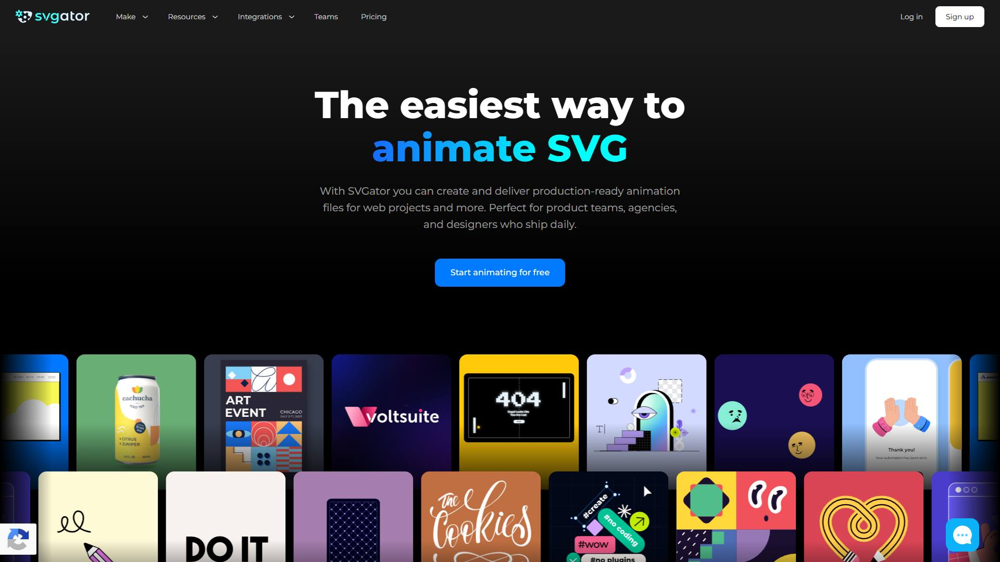
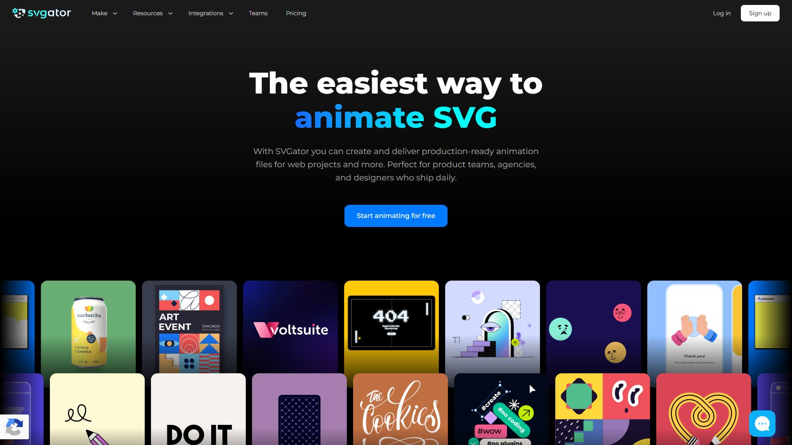
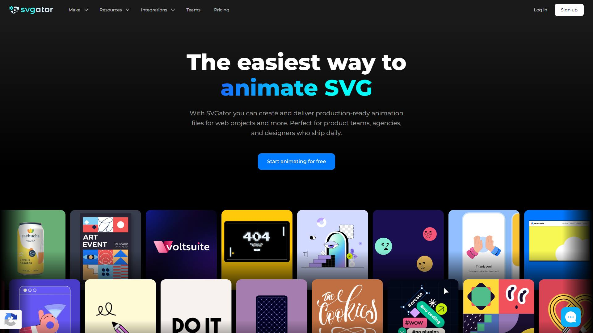
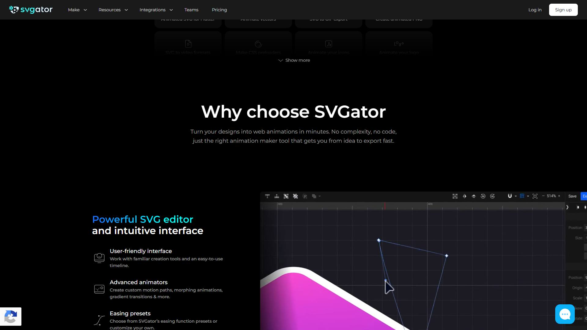
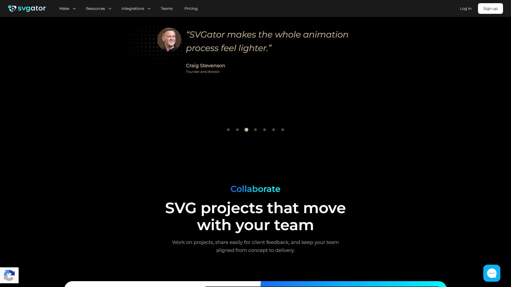
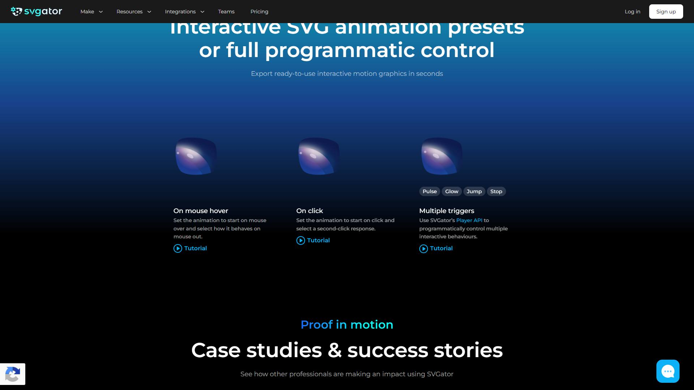
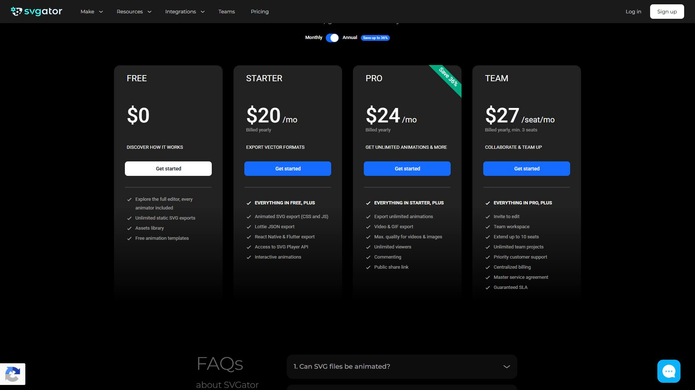
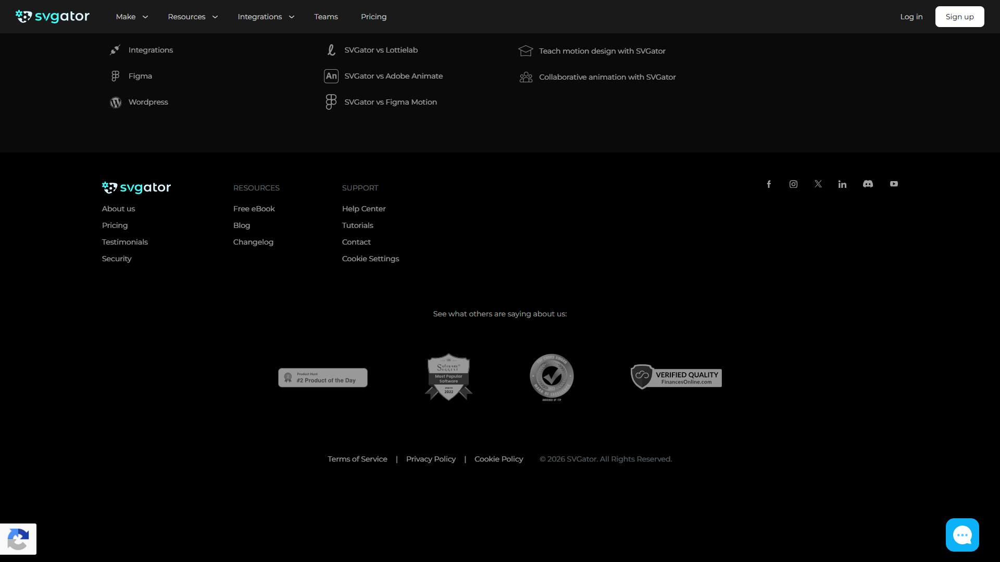

## svgator-com-blog-website-animation-examples-and-effects
<https://www.svgator.com/blog/website-animation-examples-and-effects/>

**What I like:** _(yours, one or two lines)_

- **Scheme:** unknown · bg ? · text #2b394e, #5d7179, #313b3f
- **Colours by area:** #ffffff, #000000, #f4f4f7, #1a1a1a, #166bff
- **Fonts:** Nunito, Montserrat · h1 62px/900 · body 20px
- **Radii:** 8px, 6px, 50%, 100px, 26px · **Shadows:** 1
- **Transitions (property, duration, easing):** color 0.1s ease-in-out · transform 0.3s cubic-bezier(0.2, 0, 0.1, 1) · opacity 0.2s ease-in-out · transform 0.2s ease · color 0.2s ease-in-out
- **Keyframes:** slideDownNotification, slideTopLoop, slideTopLoopImage, showSearch · scroll-driven CSS: no · reduced-motion rule: no · unreadable stylesheets: 2
- **Motion:** css · rAF 0/s idle · WAAPI calls 0 · canvases 0 (no context) · native scroll
- **Libraries seen:** three (player.module.js)
- **Rendered with:** chrome · ANGLE (AMD, AMD Radeon RX 6800 (0x000073BF) Direct3D11 vs_5_0 ps_5_0, D3D11)
- Frames: `01-hero` first screen, `01b` 0.9 s later (idle motion), `01c` after moving the cursor across the hero (reaction); the rest are scroll positions. One frame at a time: easing and feel need your eyes.

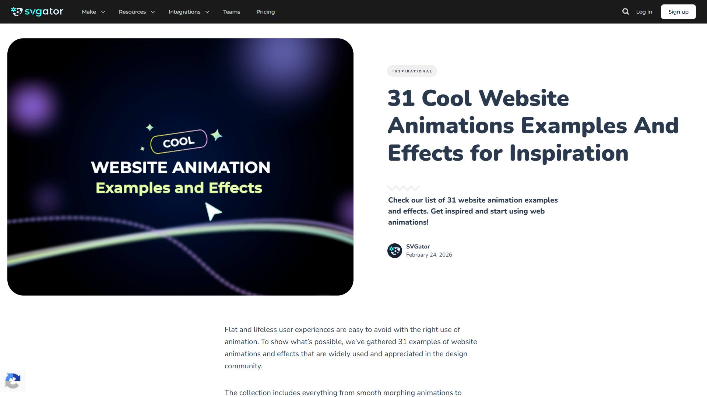
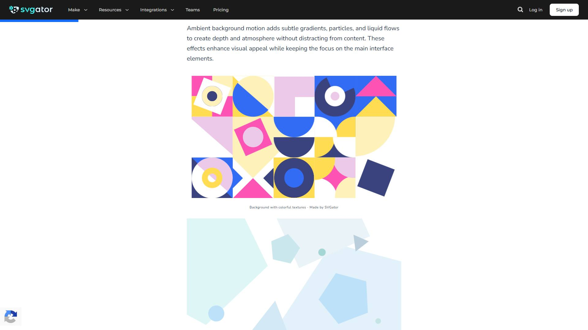
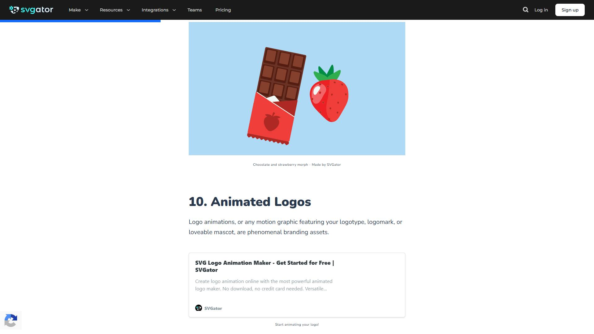
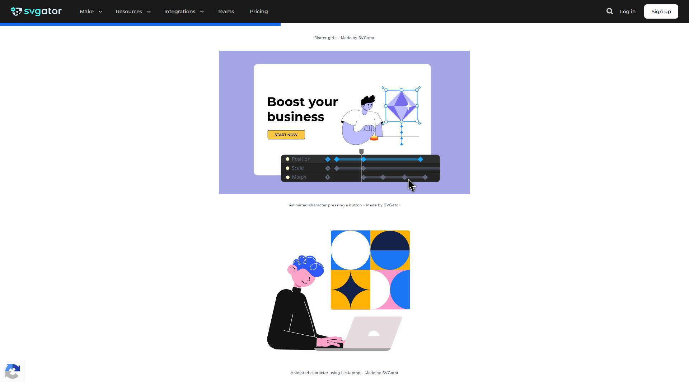
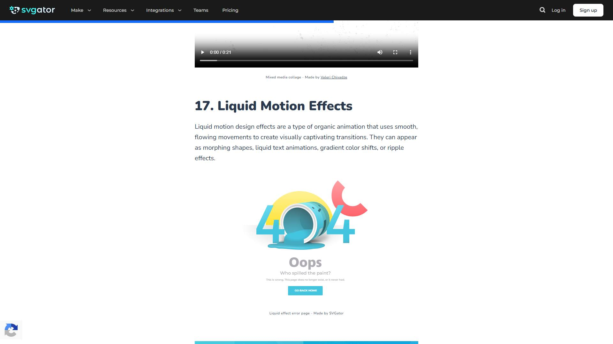
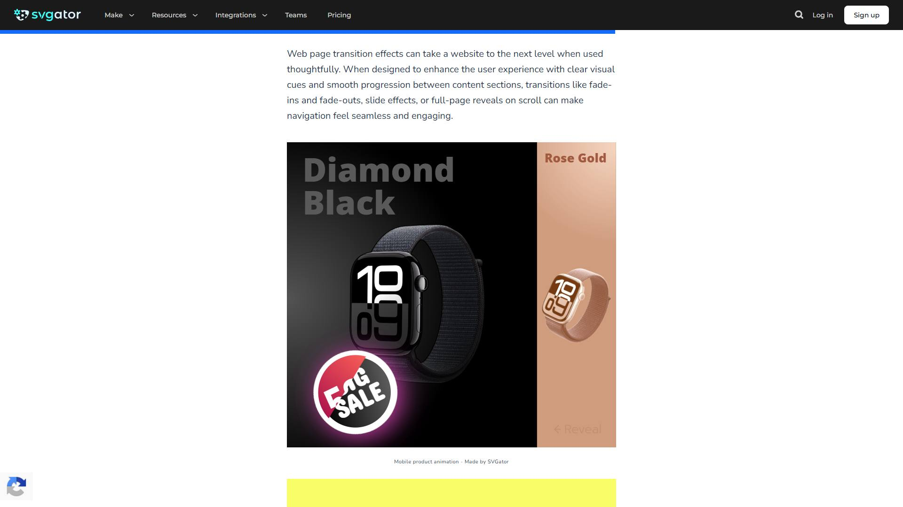

